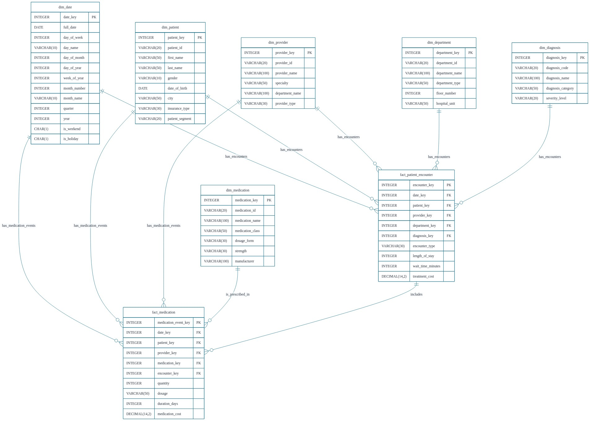

# Healthcare Operations & Patient Analytics Data Warehouse

## Overview

This project implements a SQL-based Healthcare Data Warehouse using a **Star Schema** architecture.

The warehouse is designed to organize healthcare data into analytical **fact and dimension tables**, allowing healthcare operations and patient activity to be analyzed using SQL.

The project focuses on:

* Patient encounters
* Healthcare providers
* Hospital departments
* Diagnoses
* Medications
* Patient flow
* Waiting time
* Length of stay
* Treatment costs
* Medication utilization

All data used in this project is simulated for educational purposes.

---

## Project Objectives

The main objectives of this project are to:

* Build a healthcare-focused Star Schema.
* Design fact and dimension tables.
* Organize healthcare data for analytical workloads.
* Analyze patient encounters.
* Monitor hospital department activity.
* Analyze healthcare provider workload.
* Analyze diagnoses and medication utilization.
* Measure patient waiting time.
* Analyze length of stay.
* Calculate healthcare operational KPIs.
* Apply advanced SQL analytical techniques.
* Create pre-aggregated summary data for faster analysis.

---

## Data Warehouse Architecture

The warehouse follows a **Star Schema** architecture.

### Dimension Tables

* `dim_date`
* `dim_patient`
* `dim_provider`
* `dim_department`
* `dim_diagnosis`
* `dim_medication`

### Fact Tables

* `fact_patient_encounter`
* `fact_medication`

---

## ERD

The Entity Relationship Diagram represents the relationships between the dimensions and fact tables.



---

## Star Schema

The central fact table is:

`fact_patient_encounter`

It connects healthcare activity with:

* Date
* Patient
* Provider
* Department
* Diagnosis

The medication fact table:

`fact_medication`

connects medication events with:

* Date
* Patient
* Provider
* Medication
* Patient Encounter

---

## Fact Table Grain

### fact_patient_encounter

The grain of this fact table is:

> One row represents one patient healthcare encounter.

Measures include:

* Length of stay
* Waiting time
* Treatment cost

### fact_medication

The grain of this fact table is:

> One row represents one medication event or prescription.

Measures include:

* Quantity
* Duration
* Medication cost

---

## Healthcare Analytics

The data warehouse supports analytical questions such as:

### Patient Analytics

* How many encounters does each patient have?
* How many unique patients visit the hospital?
* Which patients have frequent encounters?
* How does patient volume change over time?

### Department Analytics

* Which department has the highest patient volume?
* Which department has the longest waiting time?
* Which department generates the highest treatment cost?
* How does department activity change monthly?

### Provider Analytics

* Which healthcare providers handle the most encounters?
* What is the workload of each provider?
* Which providers have the highest patient volume?

### Clinical Analytics

* What are the most common diagnoses?
* Which diagnosis categories are most frequent?
* What is the distribution of diagnosis severity?

### Medication Analytics

* Which medications are used most frequently?
* Which medications have the highest utilization?
* What is the monthly medication cost?

---

## SQL Concepts Demonstrated

This project demonstrates several important SQL and Data Warehousing concepts:

* Database Schema Design
* Star Schema
* Fact Tables
* Dimension Tables
* Primary Keys
* Foreign Keys
* Indexing
* JOINs
* GROUP BY
* Aggregate Functions
* CASE Statements
* DISTINCT
* Subqueries
* Window Functions
* `SUM() OVER()`
* `DENSE_RANK()`
* Running Totals
* Ranking
* Analytical Queries
* Pre-aggregated Summary Tables
* Healthcare KPI Analysis

---

## Healthcare KPIs

The project calculates healthcare operational KPIs such as:

* Total Encounters
* Total Unique Patients
* Emergency Visits
* Average Waiting Time
* Average Length of Stay
* Total Treatment Cost
* Average Treatment Cost
* Medication Utilization
* Medication Cost
* Department Workload
* Provider Workload
* Top Diagnoses

---

## Summary Table

The project includes a pre-aggregated table:

`summary_daily_patient_activity`

This table summarizes healthcare activity by:

* Date
* Department

and contains metrics such as:

* Total encounters
* Unique patients
* Emergency encounters
* Average waiting time
* Average length of stay
* Total treatment cost

This approach demonstrates how pre-aggregated data can support analytical workloads and dashboard reporting.

---

## Example Analytical Questions

The SQL project answers questions such as:

```text
1. Which department has the highest number of encounters?

2. What is the average emergency department waiting time?

3. Which diagnoses are most common?

4. Which healthcare providers have the highest workload?

5. How does patient volume change by month?

6. What is the cumulative number of patient encounters?

7. Which department ranks first each month?

8. Which medications are used most frequently?

9. What is the total treatment cost per department?

10. What are the major healthcare operational KPIs?
```

---

## Data Privacy

All healthcare and patient information in this project is **simulated**.

No real patient data, medical records, or protected health information is included.

The diagnosis codes used in this project are simulated examples for analytics and database-design practice.

This project is intended for educational and portfolio purposes and is **not designed for clinical decision-making**.

---

## Future Improvements

Possible future extensions include:

* Add hospital and facility dimensions.
* Add laboratory test fact tables.
* Add radiology and medical imaging events.
* Add patient readmission analysis.
* Add patient flow analysis.
* Add healthcare quality indicators.
* Add appointment analytics.
* Add bed occupancy analytics.
* Add emergency department performance analytics.
* Build ETL pipelines using Python.
* Implement incremental data loading.
* Connect the warehouse to Power BI.
* Connect the warehouse to Tableau.
* Build an interactive healthcare analytics dashboard.

---

## Technologies

* SQL
* PostgreSQL-style SQL
* Relational Database
* Data Warehousing
* Star Schema
* Analytical SQL
* Window Functions
* Data Analytics

---

---

## Author

**Abdelrahman Osman**

Health Informatics Student | Data Analytics Enthusiast

Interested in:

* Health Informatics
* Healthcare Analytics
* SQL
* Data Analytics
* Data Warehousing
* Healthcare IT
